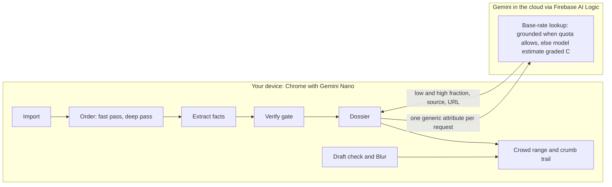

# OneOf

**How many people could you be?**

OneOf reads your own post history with on-device AI, builds the dossier an AI attacker would build from it, and estimates how small a crowd your combined facts hide you in. The result is a range, with every source shown.

*Pseudonymous until you're not.*

[](https://github.com/apexxx01/oneof/actions/workflows/ci.yml)


Live demo: **https://apexxx01.github.io/oneof/** (desktop Chrome 148+ for on-device mode; other browsers run the synthetic demo through cloud fallback)

Demo video: (coming soon)

Built for the Firebase #BuildHybridAI hackathon.

---

## Why

- **Pseudonyms leak through combinations.** Lermen et al. report 68% recall at 90% precision for LLM-driven deanonymization of online profiles, at $1–4 per profile (USENIX Security '26). Each harmless detail on its own is common; the combination is not.
- **You can't ask a server whether your own history gives you away.** Checking every draft against years of posts is only reasonable on the device that holds them.
- **Existing tools look at one post.** Per-post PII scanners and single-post estimators miss what the whole history adds up to. OneOf aggregates the full history and reports the crowd size for the combination.

## How it works

1. **Import.** Your Reddit export (`posts.csv` and `comments.csv` only), a JSON or CSV file, or pasted text. Parsing happens in the browser.
2. **Order.** A deterministic check puts posts with a life-detail cue first (fast pass), then reads everything else (deep pass). Only empty and link-only posts are skipped. It used to be a filter; on held-out SynthPAI it kept only 51% of revealing comments, so it now orders work instead of excluding it (`receipts/heldout-prefilter-synthpai.json`).
3. **Extract.** On-device Gemini Nano returns facts as schema-constrained JSON: category, value, quote, whether the fact is about the author, and certainty.
4. **Verify.** A deterministic gate drops any fact whose quote is not a verbatim substring of the post, that is not about the author, that is hypothetical, or whose value is not grounded in the text.
5. **Dossier.** Facts map to attributes with base rates. Bundled tables are used first; grounded cloud lookups fill the gaps. Nested attributes collapse into the most specific one.
6. **Estimate.** Code, not the model, computes the crowd: a Monte Carlo range (P10 to P90) with the formula behind it.



Only the arrow to the cloud leaves the device. Your posts, drafts and extracted facts do not cross it.

## The router

Every model call goes through `route(task, data)` in `src/lib/ai.ts`. The reason in the table is the text the UI shows for that call.

| Task | Data | InferenceMode | Reason shown |
|---|---|---|---|
| `extract`, `draft`, `blur` | own (your export or paste) | `ONLY_ON_DEVICE` | "Your own posts and drafts never leave this device." |
| `extract`, `draft`, `blur` | synthetic (demo persona) | `PREFER_ON_DEVICE` | "Synthetic demo data: runs on-device when available, cloud fallback allowed." |
| `baserate` | any (one generic attribute) | `ONLY_IN_CLOUD` | "Needs current statistics from Google Search. Sends one generic attribute, never your words." |

If your own data is routed `ONLY_ON_DEVICE` and no on-device model is available, the call is blocked and recorded as blocked. It does not fall back to the cloud.

## The estimator

The crowd is the number of adults in the region who share every attribute in your dossier:

```
k = N_adults(region) × Π_i min(1, f_i × c_i)

f_i  drawn log-uniformly from [low_i / s, high_i × s], then multiplied by
     the overlap lift against any earlier attribute it is known to overlap with
c_i  drawn log-uniformly from [1, 1.6] for every attribute after the first
s    spread set by the source grade
```

- **Grades.** A: official table, ±10%. B: derived from an official table or a reputable source with a URL, ×/÷2. C: rough judgement or no source, ×/÷5, shown in amber. The region population carries its own grade spread.
- **Overlaps.** Independence makes crowds too small when attributes co-occur. Known overlaps are hand-entered lifts in `src/data/baserates.ts`, for example nurse and female (about 1.7×, grade A) or single mother and divorced (3.3×, grade C). Unknown overlaps are covered by the `c_i` factor, which is a conservative assumption, not a measured value.
- **Output.** 4,000 draws, P10, P50 and P90, never a single number. A crowd is never below one person.
- **Bands** (on the median): Crowd at 10,000 or more; Neighbourhood 1,000 to 10,000; Room 10 to 1,000; Handful under 10.
- **Weight rule.** An attribute true of more than 15% of adults does not change the crowd at all.
- **Crumb trail.** The estimate is recomputed after each attribute appears, in posting order. "Left the crowd" marks the first point where the median falls below 100.
- **Rejoin the crowd.** A greedy search removes the most identifying attributes until the median reaches 1,000, and lists the posts that carry them.

Copy rules: the output never says "safe" or "identified". Every factor opens to its source, year and grade under "Show the math".

## Privacy guarantees

- **Your posts stay on the device.** Extraction, draft checks and Blur for your own data are `ONLY_ON_DEVICE`. No on-device model means the scan is blocked, not sent elsewhere.
- **The cloud sees one generic attribute per request.** A base-rate request carries an attribute such as `occupation: registered nurse` and a country name. Decoy requests with unrelated attributes are mixed in, in random order.
- **Sensitive categories never leave the device.** `health` and `religion_community` are in `LOCAL_ONLY_CATS`. They are not counted in the estimate and are never sent.
- **Every off-device call is recorded.** The in-app "What the cloud saw" panel lists each call, its mode, its reason, and the exact text sent. Entries are kept in `src/lib/ledger.ts`.
- **Reddit exports are read narrowly.** Only `posts.csv` and `comments.csv` are parsed. Every other entry (IP logs, messages, chat history, payments and similar) is listed by filename and never opened. The CSV parser keeps only text, date, subreddit or channel, and permalink, and ignores the `ip` column.

## Firebase products used

- **Firebase AI Logic, hybrid inference.** `getGenerativeModel` is called with `mode: InferenceMode[...]` set to `ONLY_ON_DEVICE`, `PREFER_ON_DEVICE`, or `ONLY_IN_CLOUD`. The on-device side uses `onDeviceParams.createOptions.initialPrompts` for the system prompt and few-shot example, and `promptOptions.responseConstraint` for the JSON schema. The cloud side uses `inCloudParams` with `gemini-3.5-flash-lite`. `initializeDeviceModel` runs the first-time Gemini Nano download from a user gesture. `response.inferenceSource` is read for every call so the ledger can show where it ran.
- **Google Search grounding.** Base-rate lookups use the cloud model with the `googleSearch` tool. The grounding source URL becomes the grade-B citation.
- **App Check.** Initialized with the reCAPTCHA v3 provider when `VITE_RECAPTCHA_V3_SITE_KEY` is set and `VITE_APPCHECK` is not `off`.
- **Planned:** Remote Config (batch size, debounce, band thresholds, prompt version) and a Firestore public base-rate cache. Neither is wired up in the current code.

## Results

Spike S1 ran Gemini Nano extraction on the synthetic persona `quietnight_rn` (200 posts, 8 planted facts, 8 traps: jokes, other people, hypotheticals). Raw results are in `receipts/s1-nano-promptv2.json`; reproduce the post-gate numbers with `npx tsx scripts/rescore.ts receipts/s1-nano-promptv2.json`.

| Configuration | Recall | Precision | Notes |
|---|---|---|---|
| On-device Gemini Nano, batch 1, prompt v2 | 88% (7 of 8 planted facts) | 20% raw; 64% after `verify()` | p50 2.5 s per call, p95 3.3 s, 98.6% valid JSON |
| Cloud baseline, `gemini-3.5-flash-lite` | re-run pending | | receipt will be added to `receipts/` |

### Held-out: SynthPAI test half (never used for tuning)

Comments sampled with a fixed seed from the test personas of SynthPAI. "Label recall" counts human-labelled attributes (hardness 1–2, certainty ≥ 3) that produced a fact in a matching category. "Quiet" comments are ones annotators marked as revealing none of SynthPAI's 8 attributes.

| Run | Calls | Errors | Label recall | Quiet comments with a fact | p50 latency |
|---|---|---|---|---|---|
| Gemini Nano, `ONLY_ON_DEVICE` (Chrome 158) | 80 | 0 | 44% (21/48) | 9/40 | 2.6 s |
| `gemini-3.5-flash-lite`, `ONLY_IN_CLOUD`, free tier | 40 | 11 (28%) | 60% (9/15) | 0/15 | 2.0 s |
| Same 29 comments the cloud answered, Nano vs cloud | 29 | | 33% vs 60% | 4/15 vs 0/15 | |
| Prompt x3 on Nano (**rejected**, see below) | 80 | 0 | 50% (24/48) | 20/40 | 3.2 s |
| Shipped `x2r` on Nano (re-run, same sample) | 80 | 0 | 40% (19/48) | 9/40 | 2.8 s |

Receipts: `receipts/heldout-synthpai-on_device.json`, `receipts/heldout-synthpai-cloud.json`.

**A regression the eval caught.** Prompt x3 was tuned on the dev personas to stop Nano throwing away the author's own job or degree as "someone else's". On dev it lifted recall from 40% to 50% at the same false-alarm rate. On the untouched test half it lifted recall 44% to 50% but more than doubled false alarms (9/40 to 20/40), nearly all invented jobs ("financial advisor" from a post about money). We rolled it back. The shipped prompt is x2 plus checker rules that only ever remove facts (`x2r`). Receipt: `receipts/heldout-synthpai-on_device-x3-rejected.json`; the rejected prompt stays in `src/lib/prompts.ts` for the record. Re-running the shipped config on the same sample gave 40% recall vs 44% for the first x2 run: Gemini Nano varies by a few points between identical runs, so differences smaller than that are noise (`receipts/heldout-synthpai-on_device-x2r.json`). What this says: on data we never tuned on, Gemini Nano catches roughly half of what the cloud model catches and makes more false calls, in exchange for zero bytes leaving the device and zero failed calls. Nano mostly finds what people state outright; it misses what has to be inferred ("crushing bugs" → developer). Closing that gap is ongoing work tuned on the dev half only.

### Full persona run, recorded

`receipts/p1-nano-run-2026-11-24.compact.json`: all 200 posts of `quietnight_rn` on Gemini Nano in Chrome 158, 0 errors, 0 bytes of posts sent, 10 min. The estimate (one of ~50, range 7–330; edit 3 posts to get back to ~5.6k) matches the answer-key dry run, because noise facts such as "Sunday" or "member of group chat" have no base rate and do not change the crowd. This recording is what browsers without Nano play back, labelled as a replay.

Caveats, stated plainly:

- The `verify()` gate was tuned on this same persona. The held-out check is `/?eval`: SynthPAI (Yukhymenko et al., NeurIPS 2024, CC BY-NC-SA 4.0), split by persona, test half never used for tuning, fetched live from Hugging Face and never vendored. Results land in `receipts/heldout-synthpai-*.json`.
- The 64% precision after `verify()` is below the 80% precision bar in the spike gate, so the on-device path does not yet match the cloud baseline on precision.
- The receipt's grounding test returned HTTP 429 quota errors on the free tier. Grounded base rates were therefore not verified in S1. Without grounding, a live estimate is graded C and labelled "model estimate, no source".
- One synthetic persona is not a general accuracy claim; the SynthPAI samples are small (80 and 40 comments).

## Quickstart

Requirements: Node.js, and desktop Chrome 148 or later for on-device mode. Check `chrome://on-device-internals` for the model status. The model download needs about 22 GB free on the drive that holds the Chrome profile.

```bash
npm install
cp .env.example .env.local   # fill in the Firebase web app values
npm test                     # unit, property and regression tests
npm run dev                  # http://localhost:5173
```

- Set `VITE_APPCHECK=off` in `.env.local` for local runs until App Check is configured.
- In dev, the console prints an App Check debug token. Register it under App Check, Manage debug tokens. Never commit it.
- Click "Download Gemini Nano (one time)" on the home page. The download needs a user gesture.
- The spike benchmark page is at `/?spike`; the held-out SynthPAI evaluation is at `/?eval`.
- The synthetic persona "quietnight_rn" runs on the home page. It is labelled SYNTHETIC on screen.

## Guardrails

- Input is your own export file or pasted text only. There is no username lookup and no scraping.
- Output is a range and your own evidence. It never includes a name, never guesses an identity, and never says "safe".
- Sensitive categories stay local and are not counted.
- Synthetic personas are labelled as synthetic on screen.
- English only. The app states this on screen.

## Prior art and credits

- **BRANCH / Privacy Mirror** (CMU, arXiv 2503.09674). Estimates one post, with base rates from what an LLM remembers. OneOf aggregates the full history and uses cited tables.
- **Krsek et al.** (arXiv 2412.15047). A per-post disclosure detector that explains why a post is flagged. OneOf shows the formula and a quote for every flag.
- **reddacted** and **Redact.dev**. PII scanning and bulk deletion. OneOf reports a crowd range and the smallest set of posts to edit.
- **Lermen et al.**, "Large-scale online deanonymization with LLMs", USENIX Security '26. The threat model this project responds to.

## Known limits

- English only.
- On-device mode works only in desktop Chrome 148 or later with the Gemini Nano model.
- The base-rate pack is US-first. Its only India entry is the Bengaluru Urban region. About half the attribute rates in the pack are grade C (rough, widest ranges).
- Lift values for overlaps are hand-entered and mostly grade C.
- Google Search grounding was rate-limited on the free tier. Live estimates without a source are labelled "model estimate, no source".
- The verify gate and the S1 numbers come from one synthetic persona; see the held-out SynthPAI receipts for numbers on data we never tuned on.

## License

Apache License 2.0. See [LICENSE](LICENSE).
