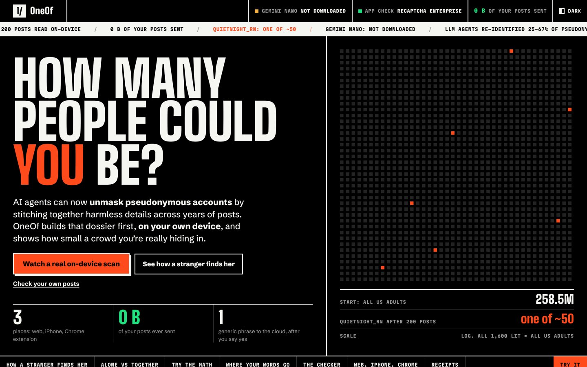
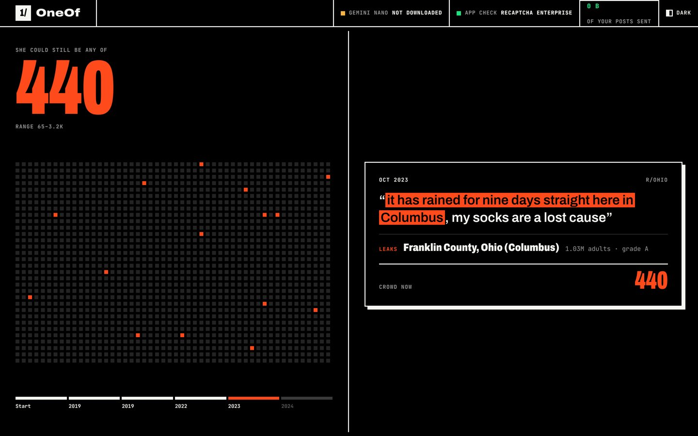
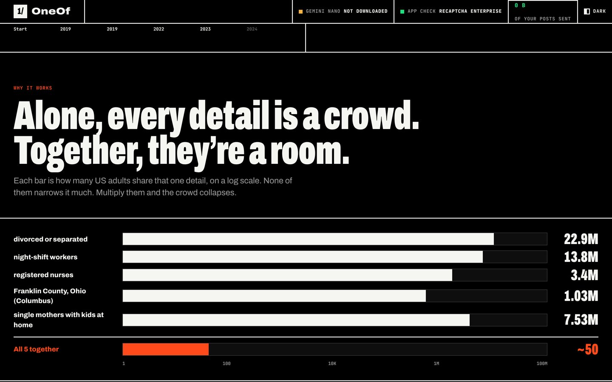
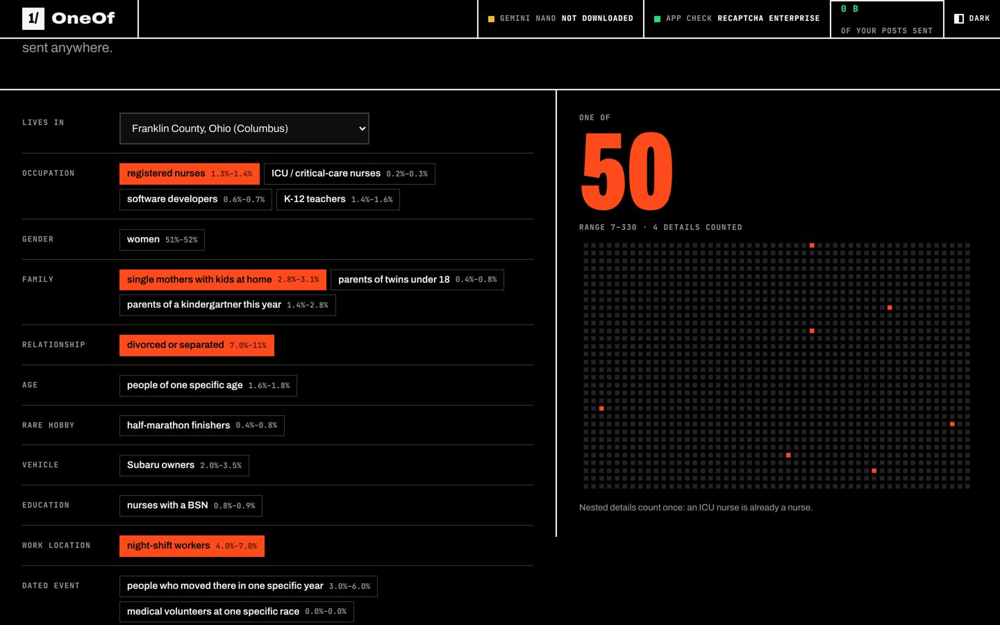
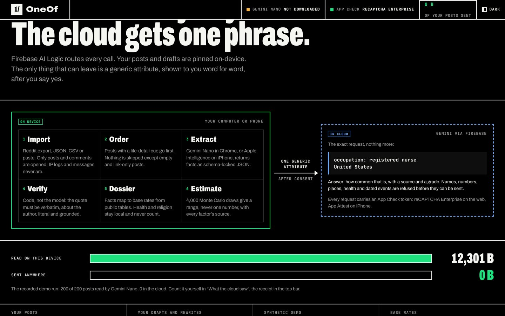
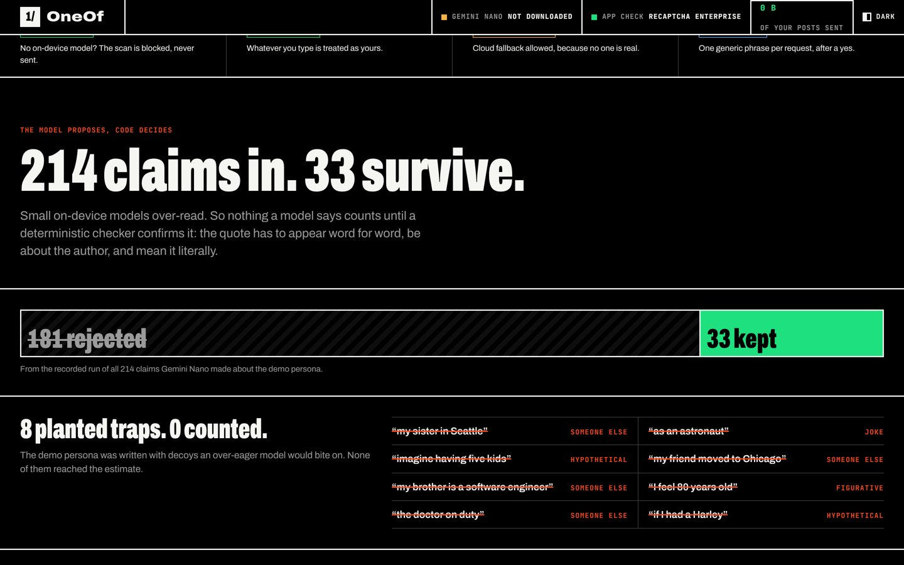
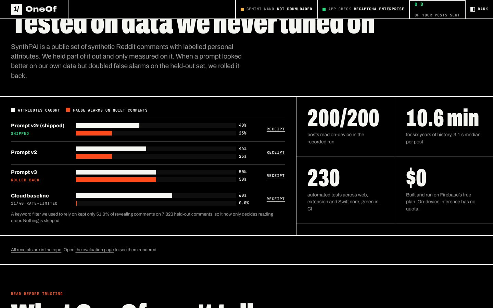
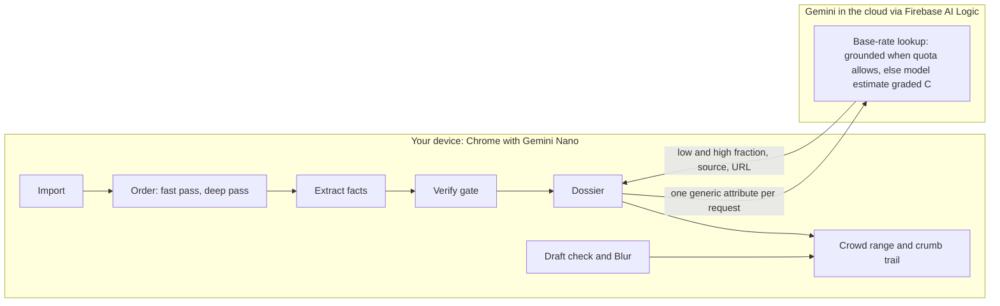

# OneOf

**How many people could you be?**

OneOf reads your own post history with on-device AI, builds the dossier an AI attacker would build from it, and estimates how small a crowd your combined facts hide you in. The result is a range, with every source shown.

*Pseudonymous until you're not.*

[](https://github.com/apexxx01/oneof/actions/workflows/ci.yml)


Live site: **https://oneof-app.vercel.app** (mirror: https://apexxx01.github.io/oneof/). It works in any browser: the explainer and the crowd calculator need no AI, browsers without Gemini Nano get a labelled replay of a recorded on-device run, and desktop Chrome with Gemini Nano (tested on Chrome 158) scans live.

Chrome extension: [`extension/`](extension/README.md) ([download the .zip](https://oneof-app.vercel.app/downloads/oneof-extension.zip), load unpacked) — checks the draft in any reply box you allow (Reddit and the [practice page](https://oneof-app.vercel.app/practice/) are built in) before you post it, on-device with Gemini Nano, with no network access at all (CSP `connect-src 'self'`).

iOS app: [`ios/`](ios/README.md) — SwiftUI on Firebase AI Logic hybrid inference, with Apple Intelligence on-device and Gemini in the cloud. It shares the web core through a golden-tested Swift port. [Receipt: 200/200 posts on-device, 0 cloud, same dossier and same number as the web build](receipts/ios/README.md)

Demo video: (coming soon)

Built for the Firebase #BuildHybridAI hackathon.



## What's on the site

Every number on the home page is computed in your browser from the committed recorded run (`public/personas/p1-replay.json`), the synthetic persona and the `receipts/` folder, with the same code the app uses.

| Section | What it shows |
|---|---|
| **The case file** | Scroll through the 5 posts (of 200) that matter. Each highlights the phrase that leaks, and the crowd field and number shrink: 258.5M → 22.9M → 1.42M → 112k → 440 → **one of ~50**. |
| **Alone vs together** | Each detail alone still leaves millions (night shift: 13.8M). All five together: ~50. Edit 2 posts and she's back to ~5.6k. |
| **Try the math** | A crowd calculator: pick ordinary details and a place, and the real estimator runs on the bundled public tables. No model, nothing sent. "Load the nurse" lands on the same ~50. |
| **Where your words go** | The six on-device steps, the one arrow to the cloud (the exact phrase sent), 12,301 B read vs 0 B sent, and the four routing rules. |
| **The checker** | 214 claims from Gemini Nano in, 33 kept by the deterministic checker. 8 planted traps, 0 counted. |
| **Web, iPhone, Chrome** | The three surfaces, and the same P50 from two different on-device models. |
| **Receipts** | Held-out SynthPAI results per prompt, including the one we rolled back, with links to every receipt. |
| **Limits** | What OneOf won't tell you. |

|  |  |
|---|---|
|  |  |
|  |  |

---

## Why

- **Pseudonyms leak through combinations.** Lermen et al. (USENIX Security '26) show LLM agents re-identifying 25–67% of Hacker News and Reddit users at 70–90% precision from pseudonymous profiles alone. Each harmless detail on its own is common; the combination is not.
- **You can't ask a server whether your own history gives you away.** Checking every draft against years of posts is only reasonable on the device that holds them.
- **Existing tools look at one post.** Per-post PII scanners and single-post estimators miss what the whole history adds up to. OneOf aggregates the full history and reports the crowd size for the combination.

## How it works

1. **Import.** Your Reddit export (`posts.csv` and `comments.csv` only), a JSON or CSV file, or pasted text. Parsing happens in the browser.
2. **Order.** A deterministic check puts posts with a life-detail cue first (fast pass), then reads everything else (deep pass). Only empty and link-only posts are skipped. It used to be a filter; on held-out SynthPAI it kept only 51% of revealing comments, so it now orders work instead of excluding it (`receipts/heldout-prefilter-synthpai.json`).
3. **Extract.** On-device Gemini Nano returns facts as schema-constrained JSON: category, value, quote, whether the fact is about the author, and certainty.
4. **Verify.** A deterministic gate drops any fact whose quote is not a verbatim substring of the post, that is not about the author, that is hypothetical, or whose value is not grounded in the text.
5. **Dossier.** Facts map to attributes with base rates. Bundled tables are used first; grounded cloud lookups fill the gaps. Nested attributes collapse into the most specific one.
6. **Estimate.** Code, not the model, computes the crowd: a Monte Carlo range (P10 to P90) with the formula behind it.



Only the arrow to the cloud leaves the device. Your posts, drafts and extracted facts do not cross it.

## The router

Every model call goes through `route(task, data)` in `src/lib/ai.ts`. The reason in the table is the text the UI shows for that call.

| Task | Data | InferenceMode | Reason shown |
|---|---|---|---|
| `extract` | own (your export or paste) | `ONLY_ON_DEVICE` | "Your own posts and drafts never leave this device." |
| `draft`, `blur` | always treated as own (it is whatever you type) | `ONLY_ON_DEVICE` | Same. Without Nano the box says "not checked"; the sample draft plays a recorded on-device result. |
| `extract` | synthetic (demo persona) | `PREFER_ON_DEVICE` | "Synthetic demo data: runs on-device when available, cloud fallback allowed." |
| `match` | any (one generic attribute, after consent for your own data) | `ONLY_IN_CLOUD` | "Picks which public table a generic attribute belongs to. Sends one generic attribute, never your words; the number always comes from the table." |
| `baserate` | any (one generic attribute), only if no table matched | `ONLY_IN_CLOUD` | "Needs current statistics from Google Search. Sends one generic attribute, never your words." |

If your own data is routed `ONLY_ON_DEVICE` and no on-device model is available, the call is blocked and recorded as blocked. It does not fall back to the cloud.

**The cloud picks the table, never the number.** When the device finds a detail the bundled tables don't recognise, `matchTable()` sends only the generic phrase (for example `occupation: ICU charge nurse`) and the answer is schema-locked to the bundled table keys or `none`. A match counts with that table's own cited rate; the model can't supply a percentage. Only if nothing matches does OneOf ask for a rough estimate, which is shown but never counted. Live receipt: [`receipts/cloud-match-2026-11-26.json`](receipts/cloud-match-2026-11-26.json) (ICU charge nurse → ICU nurses; half-marathon finisher → half-marathon finishers; scrubs wearer, parent of toddlers, plant enthusiast, home cook → none).

## The estimator

The crowd is the number of adults in the region who share every attribute in your dossier:

```
k = N_adults(region) × Π_i min(1, f_i × c_i)

f_i  drawn log-uniformly from [low_i / s, high_i × s], then multiplied by
     the overlap lift against any earlier attribute it is known to overlap with
c_i  drawn log-uniformly from [1, 1.6] for every attribute after the first
s    spread set by the source grade
```

- **Grades.** A: official table, ±10%. B: derived from an official table or a reputable source with a URL, ×/÷2. C: rough judgement or no source, ×/÷5, shown in amber. The region population carries its own grade spread.
- **Overlaps.** Independence makes crowds too small when attributes co-occur. Known overlaps are hand-entered lifts in `src/data/baserates.ts`, for example nurse and female (about 1.7×, grade A) or single mother and divorced (3.3×, grade C). Unknown overlaps are covered by the `c_i` factor, which is a conservative assumption, not a measured value.
- **Output.** 4,000 draws, P10, P50 and P90, never a single number. A crowd is never below one person.
- **Bands** (on the median): Crowd at 10,000 or more; Neighbourhood 1,000 to 10,000; Room 10 to 1,000; Handful under 10.
- **Weight rule.** An attribute true of more than 15% of adults does not change the crowd at all.
- **Crumb trail.** The estimate is recomputed after each attribute appears, in posting order. "Left the crowd" marks the first point where the median falls below 100.
- **Rejoin the crowd.** A greedy search removes the most identifying attributes until the median reaches 1,000, and lists the posts that carry them.

Copy rules: the output never says "safe" or "identified". Every factor opens to its source, year and grade under "Show the math".

## Privacy guarantees

- **Your posts stay on the device.** Extraction, draft checks and Blur for your own data are `ONLY_ON_DEVICE`. No on-device model means the scan is blocked, not sent elsewhere.
- **The cloud sees one generic attribute per request, and only after you say yes.** A base-rate request carries an attribute such as `occupation: registered nurse` and a country name. `cloudSafeAttribute()` keeps anything that looks like a name, a number, a place, a health detail or a long phrase on the device. For your own data the app shows the exact strings and asks before sending any; the header counts these bytes separately from post bytes. (Earlier builds mixed in decoy requests; they were removed because a decoy list published in this repo is trivial to filter.)
- **Sensitive categories never leave the device.** `health` and `religion_community` are in `LOCAL_ONLY_CATS`. They are not counted in the estimate and are never sent.
- **Every off-device call is recorded.** The in-app "What the cloud saw" panel lists each call, its mode, its reason, and the exact text sent. Entries are kept in `src/lib/ledger.ts`.
- **Reddit exports are read narrowly.** Only `posts.csv` and `comments.csv` are parsed. Every other entry (IP logs, messages, chat history, payments and similar) is listed by filename and never opened. The CSV parser keeps only text, date, subreddit or channel, and permalink, and ignores the `ip` column.

## Firebase products used

- **Firebase AI Logic, hybrid inference.** `getGenerativeModel` is called with `mode: InferenceMode[...]` set to `ONLY_ON_DEVICE`, `PREFER_ON_DEVICE`, or `ONLY_IN_CLOUD`. The on-device side uses `onDeviceParams.createOptions.initialPrompts` for the system prompt and few-shot example, and `promptOptions.responseConstraint` for the JSON schema. The cloud side uses `inCloudParams` with `gemini-3.5-flash-lite`, falling back to `gemini-3.5-flash`. `initializeDeviceModel` runs the first-time Gemini Nano download from a user gesture. `response.inferenceSource` is read for every call so the ledger can show where it ran.
- **App Check, enforced.** AI Logic is set to **Enforced**: a request without a valid token gets `401 Firebase App Check token is invalid`. Every AI call uses a fresh limited-use token (`useLimitedUseAppCheckTokens`). Both live sites attest with **reCAPTCHA Enterprise** (Fraud Defense, score-based and invisible), so there is no debug token in the shipped bundle. Local dev uses the debug provider.
- **Google Search grounding.** Wired in for base-rate lookups (the grounding source URL becomes a grade-B citation), but it needs a paid plan; see below.
- **Planned:** Remote Config (batch size, debounce, band thresholds, prompt version) and a Firestore public base-rate cache. Neither is wired up in the current code.

## iOS app (Apple Intelligence)

The same product as a native iPhone app, on **Firebase AI Logic hybrid inference for Apple platforms**: Apple's Foundation Models on-device (`FirebaseAI.SystemLanguageModel`), Gemini in the cloud, `HybridModel(primary:secondary:)` for the synthetic demo, and one `GenerativeModelSession` per post.

| Data | iOS session | Same rule as the web |
|---|---|---|
| Your posts, your drafts, the blur rewrite | `SystemLanguageModel` only; refuses if Apple Intelligence is off | `ONLY_ON_DEVICE` |
| Synthetic demo persona | `HybridModel(primary: system, secondary: gemini-3.5-flash-lite)` | `PREFER_ON_DEVICE` |
| Base rates (one generic attribute, after a consent sheet) | `gemini-3.5-flash-lite` → `gemini-3.5-flash`, Google Search grounding when quota allows | `ONLY_IN_CLOUD` |

- **Where each answer ran is read from the response** (`rawResponse.modelVersion` is Apple's model name for on-device answers). It isn't inferred from the route, and the "What the cloud saw" ledger shows the exact bytes that left the phone.
- **One core, two languages.** `ios/OneOfCore` ports the checker, cloud-safe filter, estimator, dossier, base rates and router to Swift. `scripts/golden-ios.ts` runs the real TypeScript functions to generate 435 golden cases, and `swift test` (Linux or Mac) must match them: the same `mulberry32` stream bit for bit, the same verdicts and orderings, and the same crowd numbers to 1e-9. The receipt check closes the loop end to end: the web core recomputes the iPhone's crowd from the iPhone's recorded facts and gets the same P50.
- **Full persona run on the iOS 27.2 simulator:** 200/200 posts on-device, **0 cloud**, 0 unreadable replies (typed generation with `@Generable`). It finds the same dossier as the web Nano run (Columbus, registered nurse, single mother, night shift, divorced) and the **same number: P50 50.13432259896638 on the iPhone**, and the web core recomputes 50.13432259896638 in Chrome (50.13432259896637 under Node; the last digit is floating-point rounding between engines). Two different on-device models, one answer. See [`receipts/ios/`](receipts/ios/README.md).
- **What Apple's model taught us.** With the web prompt it answered `{"facts": []}` to every post. That prompt is worded as "what would help a stranger figure out who the author is", and the model declines that. OneOf's real job is the author auditing their own posts, and iOS prompt `a2` says exactly that. The model then fell for two traps the persona plants ("I feel 80 years old", "the bus driver waited for me"). Both are now rules in the **shared** deterministic checker, so the web build got stricter too.
- App Check: the debug provider on the simulator (token from a git-ignored `Secrets.xcconfig`), App Attest on devices. Firebase is pinned to **12.19.3**, the last release that ships `HybridModel` and `SystemLanguageModel` (13.0 removed them).

Run it: open `ios/OneOf.xcodeproj` in Xcode 26+ (tested on 27.2), pick an iPhone simulator on an Apple-silicon Mac with Apple Intelligence on, and press Run. Swift Package Manager fetches Firebase. `cd ios/OneOfCore && swift test` runs the parity suite.

## Built entirely on the free plan ($0)

OneOf was built and runs on Firebase's free Spark plan, by a student, with no billing account. That constraint turned out to be the clearest argument for hybrid inference:

| | On-device (Gemini Nano) | Cloud (free tier) |
|---|---|---|
| Full 200-post scan of the demo persona | 200 calls, **0 failed, 0 cloud calls, $0** (`receipts/p1-nano-run-2026-11-25-x2r.compact.json`) | rate-limited (HTTP 429) within a few dozen calls in our tests, so the live cloud demo is capped at 25 posts |
| Held-out SynthPAI eval | 80/80 calls succeeded | 11/40 calls failed (28%) (`receipts/heldout-synthpai-cloud.json`) |
| Google Search grounding | not available on-device | no free quota (grounded requests returned 429 in our tests) |

What that means in the product:
- Reading your history is on-device, so it is free and unlimited, and it can't be rate-limited or switched off by anyone else.
- Cloud base-rate lookups work without grounding, but an answer with no source is shown and **never counted** in the estimate (only bundled tables or sourced lookups narrow the crowd). The headline number never depends on the cloud.
- With a paid plan, nothing in the code changes: grounded lookups would return grade-B sources that count, and the cloud demo cap could go.

## Results

Spike S1 ran Gemini Nano extraction on the 69 posts of the synthetic persona `quietnight_rn` that passed the old keyword prefilter (of 200; 8 planted facts, 8 traps: jokes, other people, hypotheticals). The `verify()` gate was tuned on this same persona, so the 64% below is optimistic; the held-out numbers further down are the honest ones. Raw results are in `receipts/s1-nano-promptv2.json`; reproduce the post-gate numbers with `npx tsx scripts/rescore.ts receipts/s1-nano-promptv2.json`.

| Configuration | Recall | Precision | Notes |
|---|---|---|---|
| On-device Gemini Nano, batch 1, prompt v2 | 88% (7 of 8 planted facts) | 20% raw; 64% after `verify()` | p50 2.5 s per call, p95 3.3 s, 98.6% valid JSON |

### Held-out: SynthPAI test half (never used for tuning)

Comments sampled with a fixed seed from the test personas of SynthPAI. "Label recall" counts human-labelled attributes (hardness 1–2, certainty ≥ 3) that produced a fact in a matching category. "Quiet" comments are ones annotators marked as revealing none of SynthPAI's 8 attributes.

| Run | Calls | Errors | Label recall | Quiet comments with a fact | p50 latency |
|---|---|---|---|---|---|
| Gemini Nano, `ONLY_ON_DEVICE` (Chrome 158) | 80 | 0 | 44% (21/48) | 9/40 | 2.6 s |
| `gemini-3.5-flash-lite`, `ONLY_IN_CLOUD`, free tier | 40 | 11 (28%) | 60% (9/15) | 0/15 | 2.0 s |
| Same 29 comments the cloud answered (14 revealing, 15 quiet): shipped `x2r` vs cloud | 29 | | 20% (3/15) vs 60% (9/15) | 4/15 vs 0/15 | |
| Prompt x3 on Nano (**rejected**, see below) | 80 | 0 | 50% (24/48) | 20/40 | 3.2 s |
| Shipped `x2r` on Nano (re-run, same sample) | 80 | 0 | 40% (19/48) | 9/40 | 2.8 s |

Receipts: `receipts/heldout-synthpai-on_device.json`, `receipts/heldout-synthpai-cloud.json`.

**A regression the eval caught.** Prompt x3 was tuned on the dev personas to stop Nano throwing away the author's own job or degree as "someone else's". On dev it lifted recall from 40% to 50% at the same false-alarm rate. On the untouched test half it lifted recall 44% to 50% but more than doubled false alarms (9/40 to 20/40), nearly all invented jobs ("financial advisor" from a post about money). We rolled it back. The shipped prompt is x2 plus checker rules that only ever remove facts (`x2r`). Receipt: `receipts/heldout-synthpai-on_device-x3-rejected.json`; the rejected prompt stays in `src/lib/prompts.ts` for the record. Re-running the shipped config on the same sample gave 40% recall vs 44% for the first x2 run: Gemini Nano varies by a few points between identical runs, so differences smaller than that are noise (`receipts/heldout-synthpai-on_device-x2r.json`). What this says, with small samples: on data we never tuned on, the on-device model catches clearly less than the cloud model (20–44% of labels vs 60% for the cloud on the comments it answered) and makes more false calls, in exchange for zero bytes leaving the device and zero failed calls. Counted the other way, the free-tier cloud's 11 failed calls make its recall 39% (9/23) over everything it was asked. Because missed facts make the crowd look bigger, the app tells users to treat the number as an upper bound. Nano mostly finds what people state outright; it misses what has to be inferred ("crushing bugs" → developer). Closing that gap is ongoing work tuned on the dev half only.

### Full persona run, recorded

Two full recordings of `quietnight_rn` on Gemini Nano in Chrome 158, all 200 posts on-device, 0 errors, 0 bytes of posts sent, about 10 minutes each: `receipts/p1-nano-run-2026-11-24.compact.json` (prompt x2) and `receipts/p1-nano-run-2026-11-25-x2r.compact.json` (shipped prompt x2r, used for the replay). Both give one of ~50 (range 7–330) and back to ~5.6k after editing 2–3 posts. The runs differ in detail (the x2r run also fell for one planted trap, "my sister in Seattle", which doesn't count because Seattle is not a bundled region), which is why only cited base rates are allowed to narrow the crowd: an unsourced model estimate for a noise fact like "home cook" is shown but never counted. This recording is what browsers without Nano play back, labelled as a replay.

Caveats, stated plainly:

- The `verify()` gate was tuned on this same persona. The held-out check is `/?eval`: SynthPAI (Yukhymenko et al., NeurIPS 2024, CC BY-NC-SA 4.0), split by persona, test half never used for tuning, fetched live from Hugging Face and never vendored. Results land in `receipts/heldout-synthpai-*.json`.
- The 64% precision after `verify()` is below the 80% precision bar in the spike gate, so the on-device path does not yet match the cloud baseline on precision.
- The receipt's grounding test returned HTTP 429 quota errors on the free tier. Grounded base rates were therefore not verified in S1. Without grounding, a live estimate is graded C and labelled "model estimate, no source".
- One synthetic persona is not a general accuracy claim; the SynthPAI samples are small (80 and 40 comments).

## Quickstart

Requirements: Node.js, and desktop Chrome with the Prompt API and Gemini Nano for on-device mode (tested on Chrome 158). Check `chrome://on-device-internals` for the model status. The model download needs about 22 GB free on the drive that holds the Chrome profile.

```bash
npm ci
npm test                     # 154 tests: 88 web (unit, property, regression, privacy invariants) + 66 extension
npm run ext:build            # the extension's bundle tests run against extension/dist when it exists
# cd ios/OneOfCore && swift test   → 18 Swift tests over 435 golden cases
npm run dev                  # http://localhost:5173
npm run build                # production build in dist/
```

- No `.env.local` is needed to try it: the public Firebase web config is built in, and the recorded replay works offline. Copy `.env.example` to `.env.local` only to point at your own Firebase project.
- App Check: in dev the console prints a debug token; register it under App Check → Manage debug tokens (never commit it). Set `VITE_APPCHECK=off` to skip App Check for a local run. Production builds read `VITE_RECAPTCHA_ENTERPRISE_SITE_KEY` (a public site key; Vercel env var or GitHub repository variable). `VITE_APPCHECK_DEBUG_TOKEN` still works as a fallback but puts the token in the bundle, so the live sites don't use it.
- `/?replay` offers the recorded run even in a browser that has Nano.
- A synthetic Reddit export to try the importer: [`quietnight_rn-reddit-export.zip`](https://oneof-app.vercel.app/personas/quietnight_rn-reddit-export.zip) (it includes decoy `ip_logs.csv` and `messages.csv` files that OneOf never opens).
- Cloud model chain: `gemini-3.5-flash-lite` first; on a timeout or quota error, `gemini-3.5-flash`.
- Click "Download Gemini Nano (one time)" on the home page. The download needs a user gesture.
- The spike benchmark page is at `/?spike`; the held-out SynthPAI evaluation is at `/?eval`.
- The synthetic persona "quietnight_rn" runs on the home page. It is labelled SYNTHETIC on screen.

## Guardrails

- Input is your own export file or pasted text only. There is no username lookup and no scraping.
- Output is a range and your own evidence. It never includes a name, never guesses an identity, and never says "safe".
- Sensitive categories stay local and are not counted.
- Synthetic personas are labelled as synthetic on screen.
- English only. The app states this on screen.

## Prior art and credits

- **Zheng, Das, Ritter, Xu** (arXiv 2503.09674), LLM-based k-anonymity estimation. Estimates one post, with base rates from what an LLM remembers. OneOf aggregates the full history and uses cited tables.
- **Krsek et al.** (arXiv 2412.15047). A per-post disclosure detector that explains why a post is flagged. OneOf shows the formula and a quote for every flag.
- **reddacted** and **Redact.dev**. PII scanning and bulk deletion. OneOf reports a crowd range and the smallest set of posts to edit.
- **Lermen et al.**, "Large-scale online deanonymization with LLMs", USENIX Security '26. The threat model this project responds to.

## Known limits

- English only.
- On-device mode works only in desktop Chrome with Gemini Nano (tested on Chrome 158), or on an iPhone or simulator with Apple Intelligence on (iOS 26+).
- The iOS prompt (`a2`) has been run on the demo persona only; the held-out SynthPAI numbers describe the web prompt on Gemini Nano.
- The base-rate pack is US-first. Its only India entry is the Bengaluru Urban region. About half the attribute rates in the pack are grade C (rough, widest ranges).
- Lift values for overlaps are hand-entered and mostly grade C.
- Built on the free plan: Google Search grounding has no free quota, so live lookups are unsourced (shown, never counted), and the cloud path is rate-limited. See "Built entirely on the free plan".
- The verify gate and the S1 numbers come from one synthetic persona; see the held-out SynthPAI receipts for numbers on data we never tuned on.

## License

Apache License 2.0. See [LICENSE](LICENSE).
