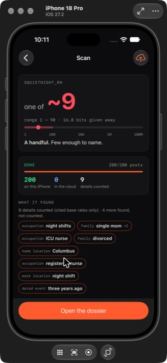
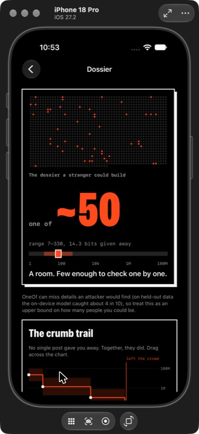
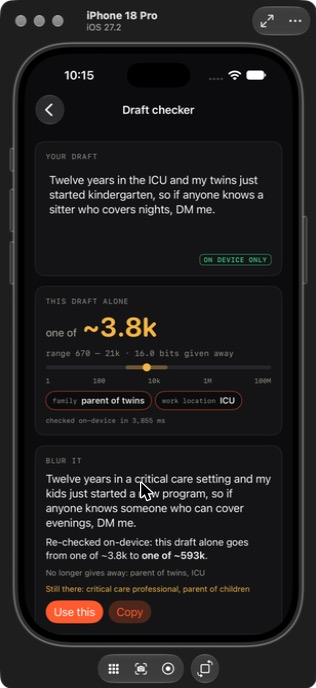

# OneOf for iPhone

The same product as the web app, native on iOS: OneOf reads your own posts with **Apple's on-device model through Firebase AI Logic**, builds the dossier a stranger could build from them, and tells you how many people you could be.

| Scan: 200/200 on this iPhone, 0 cloud | Dossier and crumb trail | Draft check and blur |
|---|---|---|
|  |  |  |

## How it uses hybrid inference

| What | Session | Why |
|---|---|---|
| Your posts, your drafts, the rewrite | `FirebaseAI.SystemLanguageModel` only. If Apple Intelligence is off, OneOf refuses. | Nothing you wrote should leave the phone |
| The synthetic demo persona | `HybridModel(primary: SystemLanguageModel.default, secondary: gemini-3.5-flash-lite)` | On-device first, cloud as a fallback for people without Apple Intelligence |
| Public statistics (base rates), after a consent sheet that shows the exact text | `gemini-3.5-flash-lite` → `gemini-3.5-flash`, Google Search grounding when quota allows | Needs current numbers from the world, never your words |

- **Typed output.** Extraction uses guided generation: `session.respond(to:generating: GFactBatch.self)` with a `@Generable` schema. Apple's model is constrained to it on-device, and Firebase sends the same schema to Gemini when the hybrid session falls back.
- **Checked, not trusted.** Every answer is read back with `rawResponse.modelVersion`. An own-data answer that didn't come from the on-device model is thrown away. The deterministic checker (`OneOfCore/Verify.swift`) drops hallucinated quotes, hypotheticals, details about someone else, and figures of speech before anything counts.
- **Blur, re-checked.** The rewrite uses `SystemLanguageModel(guardrails: .permissiveContentTransformations)` and is then re-checked on-device, so "before → after" is measured, not claimed.
- **Ledger.** "What the cloud saw" lists every call and the exact bytes that left the phone, split into your posts (always 0) and demo posts.
- **App Check.** The debug provider runs on the simulator, with the token in a git-ignored `Secrets.xcconfig` and never in device builds. App Attest runs on devices.
- **Siri, Shortcuts, Spotlight, Action button.** "Check a draft with OneOf" (`CheckDraftIntent`) opens the draft checker with your text.

## One core, two languages

`OneOfCore` is a Swift port of the web app's checker, cloud-safe filter, estimator, dossier, base rates and router. `scripts/golden-ios.ts` runs the real TypeScript functions to produce 400+ golden cases, and `swift test` must match them all: the same random stream bit for bit, the same verdicts, and the same crowd numbers to 1e-9. CI runs it on Linux on every push. `scripts/recheck-ios-receipt.ts` lets the web core recompute an iPhone run from its receipt.

## Receipts

Full persona runs on the iOS 27.2 simulator: 200/200 posts on-device, 0 cloud, Columbus + nurse + single mother + night shift + divorced → one of ~50 (P50 50.13432259896638), the same dossier and number as the web run. See [`../receipts/ios/`](../receipts/ios/README.md). On a device without Apple Intelligence the app offers a labelled replay of that recorded run, facts re-checked by today's checker.

## Run it

1. Xcode 26 or later (tested on 27.2), an Apple-silicon Mac with Apple Intelligence on.
2. Open `ios/OneOf.xcodeproj`, pick an iPhone simulator, and press Run. Swift Package Manager fetches Firebase **12.19.3**, the last release with `HybridModel` and `SystemLanguageModel`.
3. Optional, for the cloud half: put `GoogleService-Info.plist` in `ios/OneOf/`, and copy `Secrets.xcconfig.example` to `Secrets.xcconfig` with an App Check debug token registered for the iOS app.
4. `cd ios/OneOfCore && swift test` runs the parity suite (macOS or Linux).

API notes from building against the SDK source: [`docs/ios-firebase-api-notes.md`](../docs/ios-firebase-api-notes.md).
